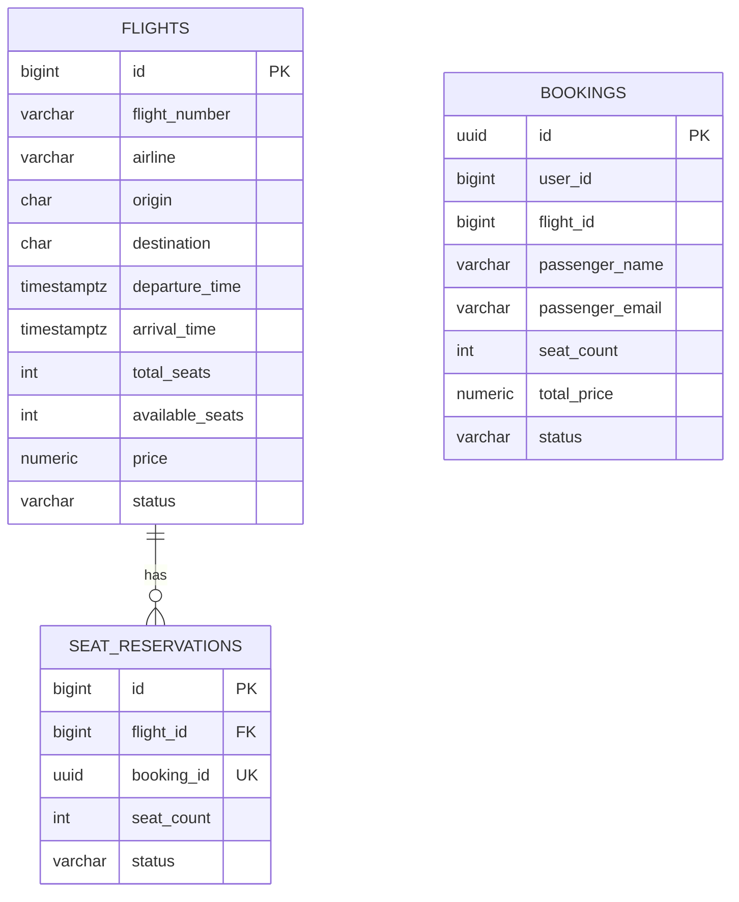

# ER-диаграмма (3NF)

**Ограничения целостности:**
- `flights.total_seats > 0`
- `flights.price > 0`
- `0 <= flights.available_seats <= flights.total_seats`
- `UNIQUE(flight_number, departure_time)`
- `seat_reservations.seat_count > 0`
- `seat_reservations.booking_id UNIQUE`
- `bookings.seat_count > 0`
- `bookings.total_price > 0`
